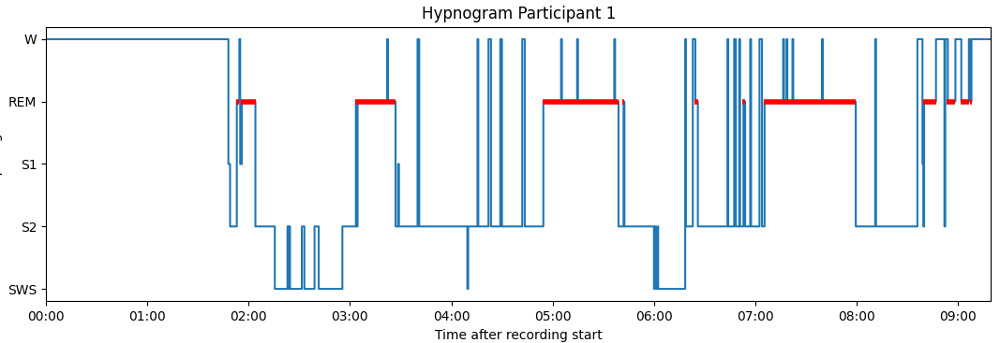
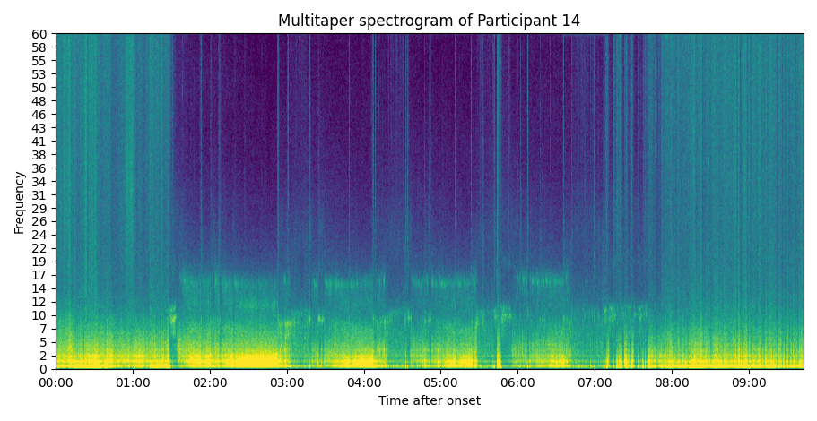
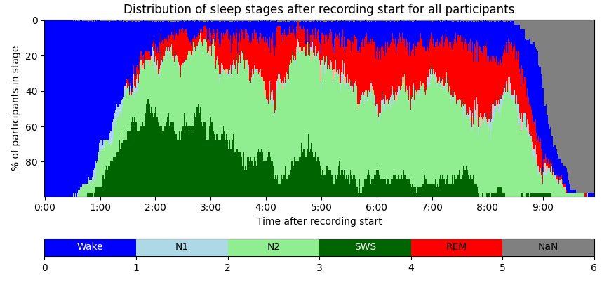

# sleep-utils

A python toolbox for sleep researchers. Plot hypnograms, spectrograms, confusion matrices, PSG summaries







```
Hypnogram summary
{'TRT': 460.5,
 'TST': 444.5,
 'WASO': 16.0,
 'lat_REM': 65.0,
 'lat_N1': 0.0,
 'lat_N2': 2.0,
 'lat_SWS': 9.0,
 'min_REM': 109.5,
 'min_N1': 13.5,
 'min_N2': 214.0,
 'min_SWS': 107.5,
 'perc_REM': 0.24634420697412823,
 'perc_N1': 0.030371203599550055,
 'perc_N2': 0.4814398200224972,
 'perc_SWS': 0.24184476940382452,
 'perc_W': 0.03474484256243214,
 'recording_length': 547.0,
 'sleep_offset_after_rec_start': 534.0,
 'sleep_onset_after_rec_start': 73.5}
```

#### Install

```
pip install sleep-utils
```

or

```
pip install git+https://github.com/skjerns/sleep-utils
```

## Modules

The `sleep-utils` package is organized into several modules, each providing specific functionalities for sleep data analysis.

### `sleep_utils.gui`

This module provides graphical user interface (GUI) components built with `tkinter`. It simplifies tasks like selecting files and folders, and getting user input, making your scripts more interactive.

### `sleep_utils.plotting`

A comprehensive module for creating various plots related to sleep analysis. You can use it to:
- Plot hypnograms
- Generate spectrograms of EEG data
- Visualize confusion matrices for inter-rater reliability
- Plot noise characteristics of your signals

### `sleep_utils.sigproc`

This module contains a collection of functions for signal processing of physiological data. Key features include:
- Filtering and resampling signals
- Detecting artifacts in your data
- Heuristics for spindle detection and other sleep-related events.

### `sleep_utils.tools`

A set of utility functions that make working with sleep data easier. This module provides tools for:
- Reading and writing hypnograms in various formats
- Calculating and summarizing sleep statistics (e.g., TST, WASO, sleep efficiency) based on AASM guidelines.
- Inferring relationships between PSG and hypnogram files.

### `sleep_utils.usleep_utils`

This module provides a convenient wrapper around the [U-Sleep API](https://sleep.ai.ku.dk) for automatic sleep staging. You can use it to:
- Predict sleep stages from EEG/EOG data using the U-Sleep model
- Manage prediction sessions with the API
- It supports both `mne.io.Raw` objects and EDF files as input.

By default requests go to the public service at https://sleep.ai.ku.dk. If you run your
own U-Sleep server, point the functions at it with `url=`:

```python
hypno = predict_usleep(edf_file, api_token, eeg_chs=..., eog_chs=...,
                       url="http://my-usleep-server:8887")
```

Alternatively set the `USLEEP_API_URL` environment variable to redirect every call without
touching any code. `predict_usleep`, `predict_usleep_raw` and `delete_all_sessions` all
accept `url=`; omitting it keeps the previous behaviour.